# Hướng dẫn sử dụng – Ứng dụng quản lý người dùng

Video demo: [demo/demo_mobile.mp4](demo/demo_mobile.mp4) · Ảnh tổng hợp: [demo/tong_hop_anh.png](demo/tong_hop_anh.png)

Tài khoản mẫu: **admin@midterm.com / admin123** (admin) · **nguyenvana@gmail.com / 123456** (người dùng thường)

---

## Flow 0 – Khởi động hệ thống

1. **Bật Docker Desktop**, chờ đến khi Docker báo đang chạy.
2. **Chạy database + API** tại thư mục dự án: `docker compose up -d --build`.
3. **Kiểm tra API**: mở http://localhost:8080/health, thấy `"status":"ok"` là được.
4. **Chạy trên web**: `flutter run -d chrome`.
5. **Chạy trên di động**: mở emulator rồi `flutter run -d emulator-5554`.
   Nếu emulator lỗi đồ hoạ, mở bằng `emulator -avd pixel -gpu swiftshader_indirect`.

## Flow 1 – Đăng nhập

1. **Nhập email và mật khẩu** vào hai ô trên màn hình đăng nhập.
   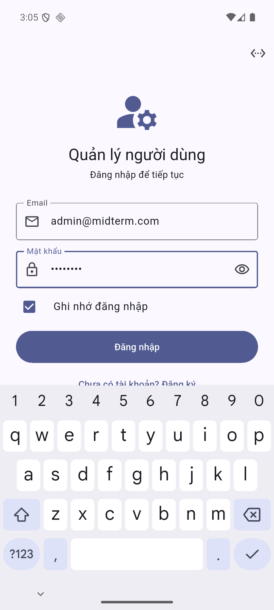
2. **Bấm “Đăng nhập”** (hoặc Enter). Admin vào module quản lý, người dùng thường vào trang hồ sơ.
3. **“Ghi nhớ đăng nhập”** giữ phiên cho lần mở app sau, bỏ tick nếu không muốn.

## Flow 2 – Đăng ký tài khoản

1. **Bấm “Chưa có tài khoản? Đăng ký”** ở màn hình đăng nhập.
2. **Nhập email, họ tên, mật khẩu, nhập lại mật khẩu**, có thể chọn ảnh đại diện.
3. **Bấm “Đăng ký”**: tài khoản được tạo và tự đăng nhập luôn.

## Flow 3 – Xem danh sách người dùng (admin)

1. **Xem thống kê** ở 3 thẻ trên cùng: tổng số, có ảnh, không ảnh.
   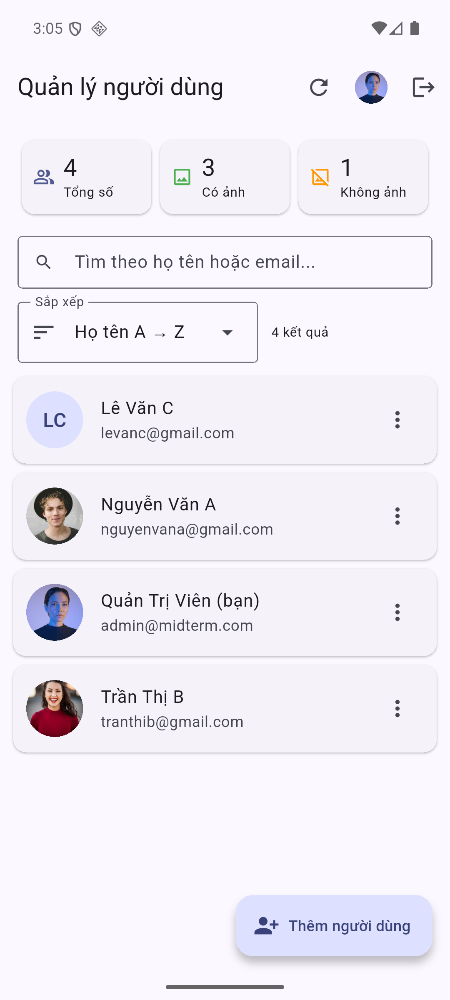
2. **Tìm kiếm** bằng cách gõ họ tên hoặc email vào ô tìm kiếm, kết quả lọc tự động.
3. **Sắp xếp** bằng menu “Sắp xếp”: họ tên hoặc email, A → Z hoặc Z → A.
4. **Làm mới** bằng nút ⟳ hoặc kéo danh sách xuống (trên di động).
   Trên web màn hình rộng, danh sách hiển thị dạng bảng có cột mật khẩu (ẩn/hiện).

## Flow 4 – Thêm người dùng

1. **Bấm “Thêm người dùng”** ở góc dưới bên phải.
   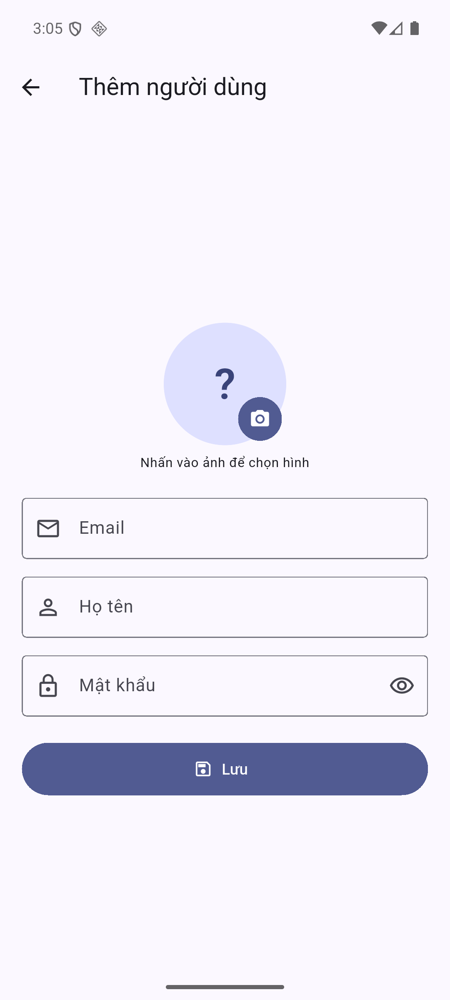
2. **Nhập email, họ tên, mật khẩu** (mật khẩu tối thiểu 6 ký tự).
3. **Bấm vào ảnh tròn** để chọn nguồn ảnh: thư viện, chụp ảnh (di động), file (web) hoặc nhập URL.
   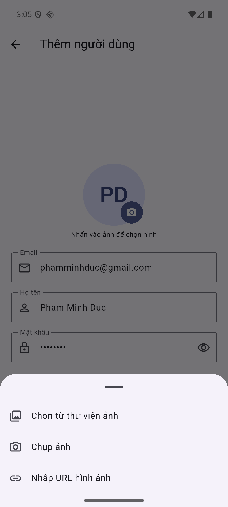
4. **Chọn ảnh** trong thư viện, ảnh hiện ngay trên form.
   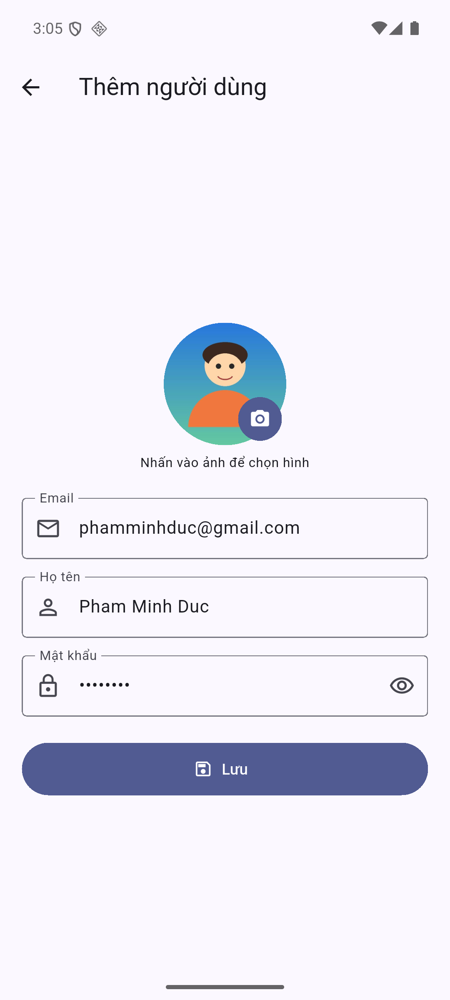
5. **Bấm “Lưu”**: người dùng mới xuất hiện trong danh sách kèm thông báo.
   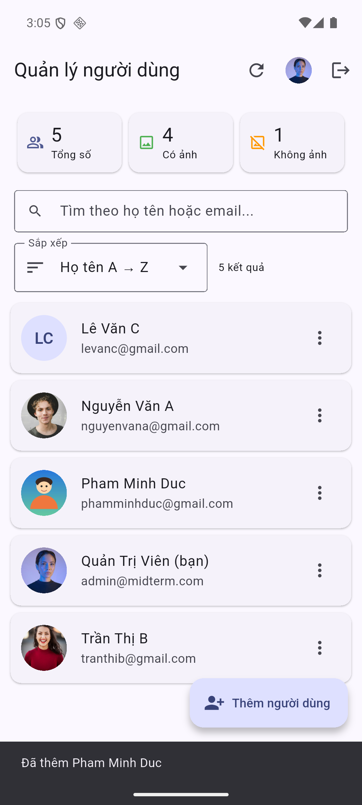

## Flow 5 – Xem chi tiết người dùng

1. **Bấm vào một người dùng** trong danh sách để mở trang chi tiết.
   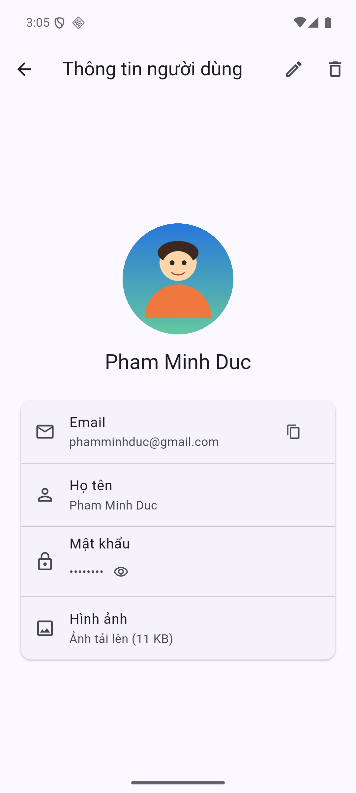
2. **Bấm biểu tượng 👁** cạnh mật khẩu để hiện/ẩn mật khẩu.
3. **Bấm vào ảnh** để phóng to; bấm biểu tượng sao chép để copy email.

## Flow 6 – Sửa người dùng

1. **Bấm biểu tượng ✏️** ở trang chi tiết (hoặc menu ⋮ → Sửa trong danh sách).
   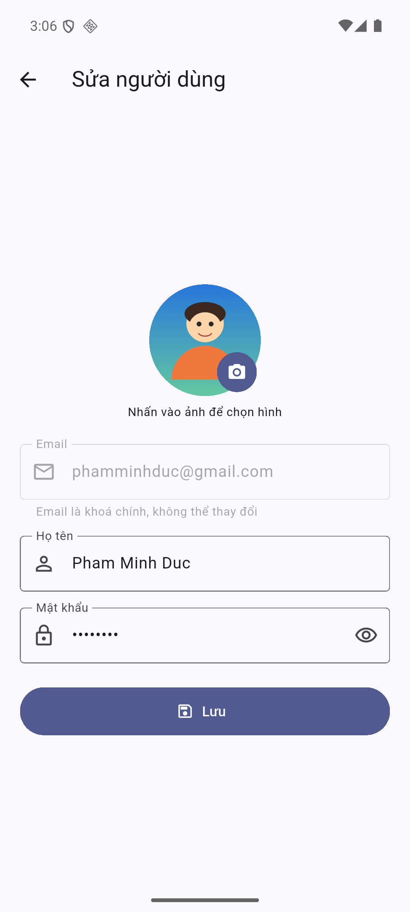
2. **Sửa họ tên, mật khẩu hoặc ảnh**. Email là khoá chính nên không sửa được.
3. **Bấm “Lưu”**: trang chi tiết cập nhật ngay với thông tin mới.
   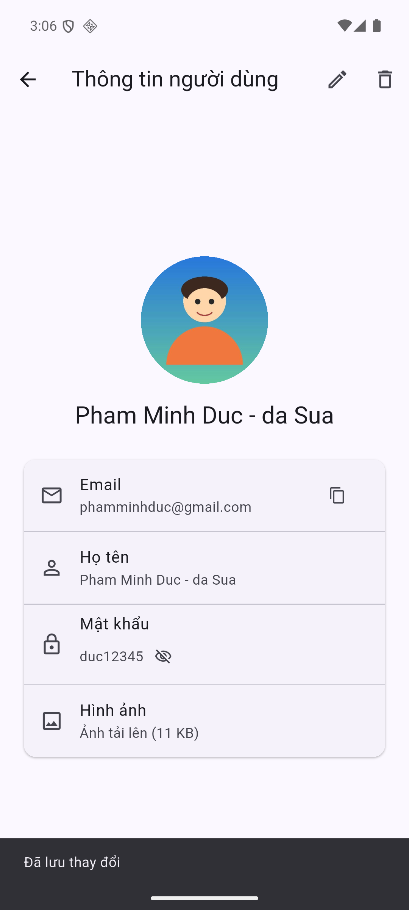

## Flow 7 – Xoá người dùng

1. **Vuốt thẻ người dùng sang trái** (di động), hoặc bấm 🗑 ở trang chi tiết hay ở bảng (web).
2. **Bấm “Xoá”** trong hộp thoại xác nhận, bấm “Huỷ” nếu đổi ý.
   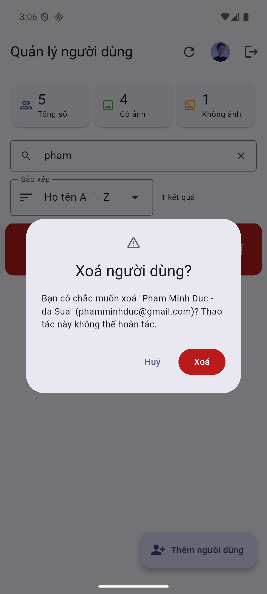
3. **Kiểm tra**: người dùng biến mất khỏi danh sách và thống kê giảm. Admin không thể tự xoá chính mình.

## Flow 8 – Hồ sơ cá nhân

1. **Admin**: bấm ảnh đại diện trên thanh tiêu đề. **Người dùng thường**: hồ sơ hiện ngay sau khi đăng nhập.
   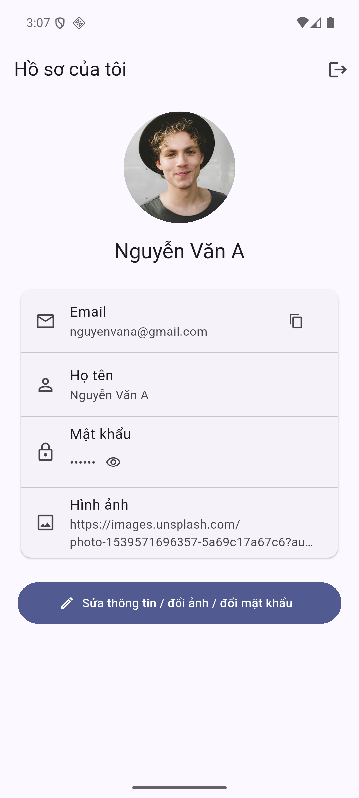
2. **Bấm “Sửa thông tin / đổi ảnh / đổi mật khẩu”** để tự cập nhật thông tin của mình, rồi bấm “Lưu”.

## Flow 9 – Đăng xuất

1. **Bấm biểu tượng ⇥** ở góc trên bên phải.
2. **Bấm “Đăng xuất”** trong hộp thoại: app quay về màn hình đăng nhập, email lần trước được điền sẵn.
   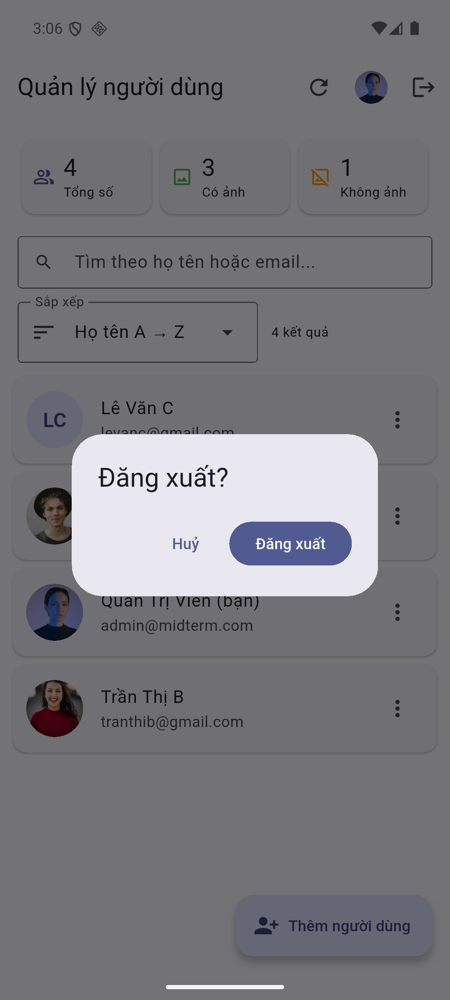

## Flow 10 – Kết nối từ điện thoại thật

1. **Cho điện thoại và máy tính dùng chung Wi-Fi**, xem IP máy tính bằng `ipconfig`.
2. **Bấm biểu tượng ⚙** trên màn hình đăng nhập, nhập `http://<IP-máy-tính>:8080`.
3. **Bấm “Kiểm tra”** để thử kết nối, rồi bấm “Lưu”.

## Flow 11 – Xem dữ liệu bằng pgAdmin

1. **Mở** http://localhost:5050, server `midterm_postgres` đã được đăng ký sẵn.
2. **Bấm vào server**, nhập mật khẩu `postgrespassword`.
3. **Xem dữ liệu** tại Databases → midterm_db → Schemas → public → Tables → `nguoidung` → View/Edit Data.
   Bảng chỉ gồm 4 cột: `email`, `matkhau`, `hoten`, `hinhanh`.

## Xử lý sự cố nhanh

| Hiện tượng | Cách xử lý |
|---|---|
| “Không kết nối được máy chủ” | Kiểm tra Docker đang chạy, mở thử http://localhost:8080/health |
| Emulator không gọi được API | Địa chỉ server phải là `http://10.0.2.2:8080` (nút ⚙) |
| `docker` báo không tìm thấy `dockerDesktopLinuxEngine` | Docker Desktop chưa bật, mở lại rồi chờ 1–2 phút |
| Muốn đưa dữ liệu về ban đầu | `docker compose down -v` rồi `docker compose up -d` |
